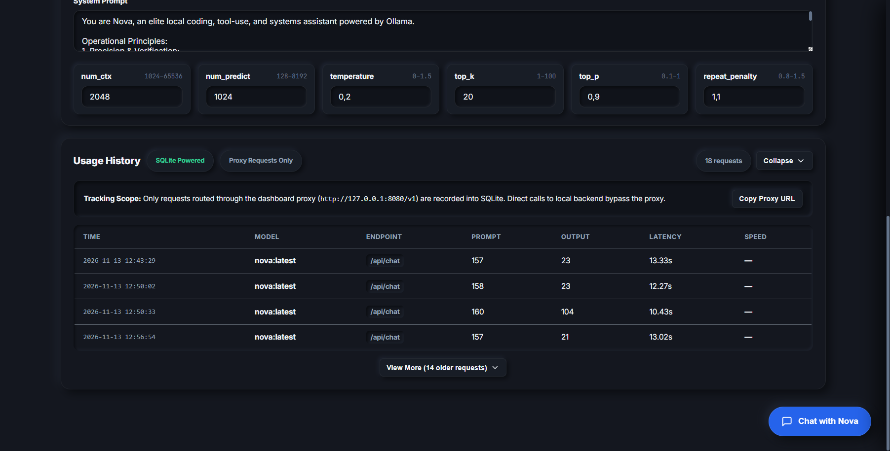
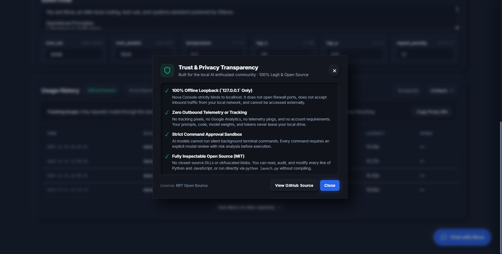
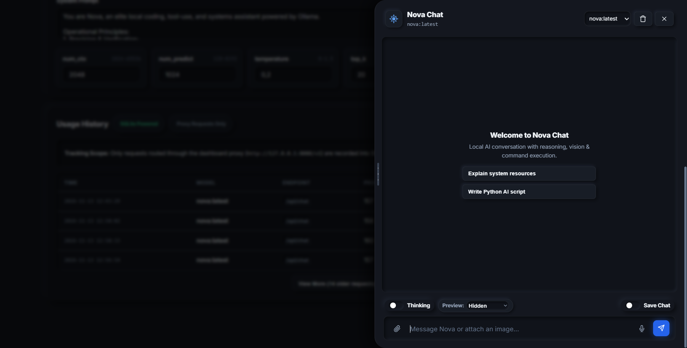

# 🌌 Nova Console

[](https://github.com/ad4rshp/nova-console)
[](https://github.com/ad4rshp/nova-console)
[](LICENSE)
[](https://github.com/ad4rshp/nova-console)
[](https://github.com/ad4rshp/nova-console)

**Nova Console** is an open-source, local AI workstation, hardware telemetry monitor, and usage-tracking proxy. It provides a visual dashboard to monitor GPU/VRAM/RAM load, chat with local AI models, tune context parameters with 1-click hardware presets, and track token usage from IDE tools like Cursor and Continue.

Works on **Windows, macOS, and Linux**, and connects automatically to any local AI engine—including **Ollama, LM Studio, vLLM, and LocalAI**.



---

## 🛡️ For AI Enthusiasts: Why You Can 100% Trust Nova Console

We understand that modern developers and AI enthusiasts are rightly cautious of random software and unknown binaries on GitHub. Here is our transparency and security guarantee:

* **100% Offline & Air-Gapped Loopback (`127.0.0.1`)**: Nova Console strictly binds to your local loopback address. It does not open firewall ports, cannot be accessed from your local Wi-Fi/LAN, and makes **zero external network requests** to any analytics, cloud, or tracking servers.
* **Zero Telemetry & Zero Data Collection**: No Google Analytics, no tracking pixels, no user fingerprinting, and no account requirements. Your prompts, code, model weights, and SQLite history never leave your computer.
* **100% Auditable Plain Source Code**: Every line of backend Python (FastAPI/Uvicorn) and frontend JavaScript is unminified and completely open for review. There are no obfuscated scripts or proprietary hidden DLLs.
* **Zero Background RAM / No Stealth Processes**: When you close Nova Console, it completely exits. It does **not** install persistent background services, hidden tray agents, or resource-heavy background miners.
* **Explicit Human Sandbox for Terminal Commands**: In Nova Chat, the AI can propose terminal actions (e.g., `git status`, `dir`), but **can never execute them silently**. Every command requires an interactive approval modal displaying the exact command, target directory, and safety risk rating (**Safe**, **Warning**, **Dangerous**).
* **Run Pure Python (No Executables Required)**: If you prefer never to run downloaded `.exe` files or batch scripts, you don't have to. You can inspect every file and start the project with standard `python launch.py`.
* **Standard MIT License**: Completely free and open-source for personal and commercial use forever.



---

## ⚡ Super Easy Installation (Quick Start)

You only need **Python 3.10+** and any local AI engine (like Ollama or LM Studio) running on your computer.

### Windows (1-Click Install or Run)
- **Instant Portable Run**: Double-click **`Start Nova Console.bat`** to run directly from this folder.
- **System Installer Setup**: Double-click **`setup_windows.bat`**. It automatically:
  1. Installs Nova Console cleanly into `%LocalAppData%\NovaConsole`
  2. Sets up an isolated Python environment
  3. Creates a **Desktop Shortcut** and **Start Menu entry**
  4. Launches Nova Console automatically

### macOS & Linux (1-Click Install or Run)
- **Instant Portable Run**: `./start.sh`
- **System Installer Setup**: `./setup_unix.sh`
  *(Installs to `~/.local/share/nova-console`, adds a `nova-console` command to your PATH, and creates a desktop app launcher)*

### Standalone Executable (.exe / Binary)
To build a single standalone binary with zero Python dependencies required for end-users:
```bash
python scripts/build_executable.py
```
This generates a single-file `NovaConsole.exe` (Windows) or `NovaConsole` binary (macOS / Linux) in the `dist/` directory.

---

## ⚡ Zero-RAM In-App Updater & Release Notifier

Nova Console includes a **zero-footprint in-app update checker**:
- **0 MB Background RAM**: Unlike bloated desktop apps, Nova Console does **not** keep any background helper or tray daemon running. The update checker runs inside the existing async loop and takes **0 bytes of extra RAM** while idle.
- **Smart Update Pill**: When I release a new version on GitHub, an animated `New: vX.X.X` pill lights up in the dashboard header. Clicking it takes the user straight to the release notes and installer download.
- **Configurable Repo**: Set `NOVA_GITHUB_REPO=ad4rshp/nova-console` in `.env` to point to your repository.

---

## 🧠 Advanced Hardware-Aware Diagnostics & Rebuild Alerts

Nova Console features a dedicated real-time hardware compatibility & diagnostic engine:
- **CPU/GPU Split Offload Detection**: When a model is too large for your GPU VRAM, Ollama automatically splits layers between GPU VRAM and system CPU RAM. Because system RAM is $\sim 10\times$ slower than GDDR6 VRAM, token generation slows drastically. Nova Console detects split offload (e.g. `52% CPU / 48% GPU`) and recommends the exact context reduction needed to fit 100% inside GPU VRAM for maximum tokens/sec.
- **Hardware Strain & OOM Protection**: If system memory is strained ($\ge 85\%$ RAM or $\ge 88\%$ VRAM) with a large context window ($>4,096$ tokens), Nova Console displays a high-priority diagnostic alert with a 1-click **"Apply Low Preset & Rebuild"** action to prevent CUDA Out-Of-Memory (OOM) crashes.
- **Modelfile Context Sync**: Alerts you whenever your saved Modelfile parameters on disk differ from the active instance currently running in VRAM.

---

## 🎛️ Model Tuning Studio: 1-Click Hardware Presets

The Model Tuning Studio allows you to customize context lengths, temperature, and system instructions with quick 1-click hardware presets:

| Preset | Target Hardware | Context (`num_ctx`) | Predict (`num_predict`) | Temp / Top-P | Purpose |
| :--- | :--- | :--- | :--- | :--- | :--- |
| **Low (2K)** | Laptops / &lt;6 GB VRAM | **2,048 tokens** | 1,024 tokens | `0.2` / `0.90` | Eliminates paging & CPU split offload on integrated or entry-level GPUs. |
| **Medium (4K)** | 6–8 GB VRAM | **4,096 tokens** | 2,048 tokens | `0.4` / `0.95` | Standard balanced profile for optimal speed and everyday coding/chat. |
| **High (8K)** | 12+ GB VRAM | **8,192 tokens** | 4,096 tokens | `0.7` / `0.95` | Full power deep-reasoning profile for heavy multi-file context and power rigs. |

*(Note: The Model Tuning Studio is completely optional. If you just want to run standard models like `llama3.2` or `deepseek-r1` as-is, you don't need to change anything!)*

### Manual Terminal Setup (All Platforms)
```bash
git clone https://github.com/ad4rshp/nova-console.git
cd nova-console
pip install -r requirements.txt
python launch.py
```

---

## 🤔 Frequently Asked Questions

### "What if I don't want a Modelfile or `nova:latest`?"
**You do NOT need to build a Modelfile or use `nova:latest`!**

Nova Console works out-of-the-box with **any model you already have installed** (such as `llama3.2`, `deepseek-r1`, `mistral`, `qwen2.5`, `phi-4`, `gemma2`, etc.):
- When you open **Nova Chat**, the dropdown automatically lists and selects the models installed on your machine.
- The **"Model Tuning Studio"** on the dashboard is an **optional power-user tool** for Ollama users who want to compile custom layer sizes or system instructions. If you just want to use standard models, you can completely ignore it!

---

## 🔌 IDE & Client Proxy Setup (Cursor, Continue, VS Code, Python)

### Why use the proxy?
Local inference engines (like Ollama) don't save history, speed metrics, or token analytics. By routing your coding assistants through Nova Console's proxy URL, you get:
- Real-time **Tokens Per Second (TPS)** speed tracking
- Exact **prompt & output token counts**
- Response **latency graphs**
- Persistent **SQLite usage history**

---

### 1. Cursor Setup
1. In Cursor, open **Settings** (`Ctrl+,` or `Cmd+,`) → search for **Models**.
2. Under **OpenAI API Key**, enter any dummy text (e.g. `nova-local`).
3. Click **Override OpenAI Base URL** and enter:
   ```text
   http://127.0.0.1:8080/v1
   ```
4. Enter your local model name (e.g. `llama3.2:latest` or `qwen2.5-coder:7b`).

---

### 2. Continue.dev Setup (VS Code / JetBrains)
Open your `~/.continue/config.json` and add Nova Console under `"models"`:
```json
{
  "models": [
    {
      "title": "Local Nova Console",
      "provider": "openai",
      "model": "llama3.2:latest",
      "apiBase": "http://127.0.0.1:8080/v1",
      "apiKey": "nova-local"
    }
  ]
}
```

---

### 3. Python (`openai` library)
Use the standard OpenAI SDK to call your local models with zero changes except for the `base_url`:
```python
from openai import OpenAI

# Connect directly to your local Nova Console proxy
client = OpenAI(
    base_url="http://127.0.0.1:8080/v1",
    api_key="nova-local"
)

response = client.chat.completions.create(
    model="llama3.2:latest",
    messages=[{"role": "user", "content": "Hello local model!"}],
    stream=True
)

for chunk in response:
    print(chunk.choices[0].delta.content or "", end="")
```

---

## ⚙️ Simple Configuration Guide

**Good news: You don't have to configure anything.** Nova Console works out of the box with zero settings changed.

If you want to customize something (for example, if you use LM Studio instead of Ollama), create a file named `.env` in this folder:

```ini
# Change this if your local AI engine runs on a different port:
# - Default Ollama:   http://127.0.0.1:11434
# - Default LM Studio: http://127.0.0.1:1234
# - Default vLLM:      http://127.0.0.1:8000
NOVA_BACKEND_URL=http://127.0.0.1:11434

# Change the port where Nova Console runs (default is 8080):
NOVA_PORT=8080

# Prevent browser from opening automatically on launch:
NOVA_NO_BROWSER=0
```

---

## 🌟 What You Can Do with Nova Console



| Feature | What it does |
| :--- | :--- |
| **Live VRAM & Hardware Monitor** | See real-time GPU VRAM, temperature, RAM usage, and disk space with sparkline graphs. |
| **One-Click VRAM Unload** | Free up graphics memory instantly by evicting idle models with a single click. |
| **Multimodal Chat (Images & Voice)** | Chat with local models, attach photos for vision-enabled models, or speak via your microphone. |
| **Draggable Resizer Drawer** | Drag the left border of the chat drawer to expand or shrink the chat width as you like. |
| **Safe Terminal Execution** | Nova Chat can propose system commands (`dir`, `git status`, `npm test`), but **always asks for your explicit permission** first. |
| **Dual Theme** | Soft-shadow daylight neumorphic theme and deep gunmetal dark mode with smooth animations. |

---

## 🛡️ Privacy & Security
- **100% Localhost**: Everything runs on your machine (`127.0.0.1`). No cloud telemetry or third-party servers.
- **Permission Gate**: The AI can never run terminal commands behind your back. Every command shows an approval popup with a safety risk rating (**LOW**, **MEDIUM**, **HIGH**, **CRITICAL**).

---

## 📄 License
MIT License. Free and open source for everyone.
